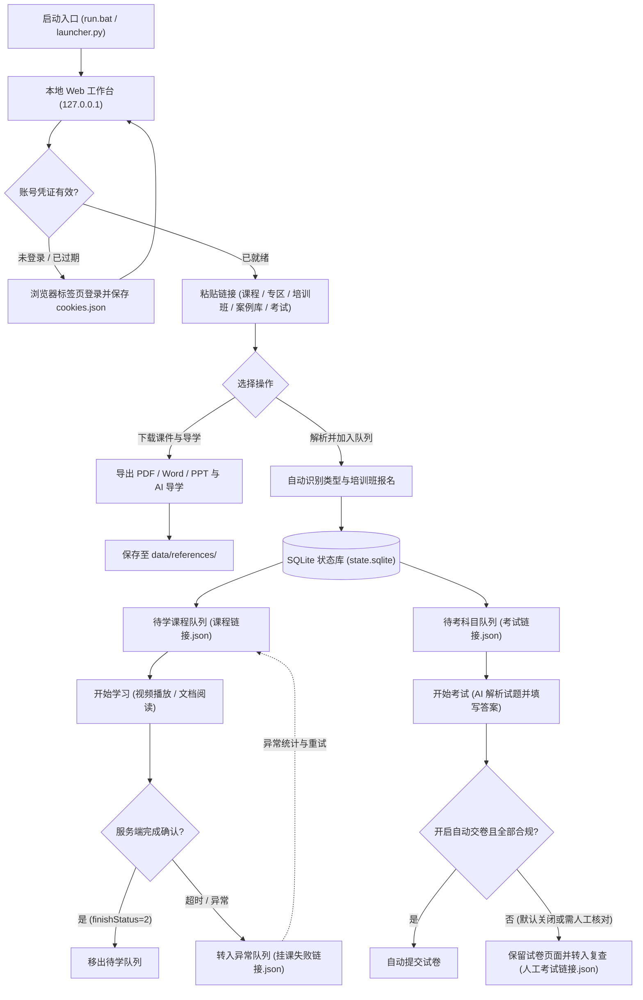

# 网上大学自动化挂课工作台

面向中国电信网上大学（知学云平台）的本地自动化工具，提供**课程收集、自动挂课（视频与文档）、AI 辅助考试答题、人工复查交卷**以及**课程参考资料导出**功能。

程序启动后自动打开本地 Web 工作台，在同一浏览器窗口内统一完成账号登录、队列管理、进度监控与日志查看。

---

## 核心功能

- **多源链接批量解析**：支持粘贴课程详情、学习专区（`topic`）、主题详情、培训班、天翼专家助手案例库（`casePool`）及独立考试链接，自动识别类型并归入对应待办队列；培训班支持自动检查报名状态并报名。
- **自动课程学习**：按队列顺序自动完成视频观看与文档阅读，自动处理课程页评分弹窗、播放遮罩与焦点恢复，并以平台服务端完成状态作为唯一完成判据。
- **AI 辅助考试与安全复查**：自动提取考题并调用大模型作答。支持在工作台直接切换「答题后自动交卷」开关（默认关闭，仅保存已答题目留待人工核对交卷）；遇到低剩余次数、题型不支持或作答不完整时自动转为人工复查，防止误交卷。
- **课程参考资料下载**：支持传入知学云主题详情链接，批量导出课程 PDF、Word、PowerPoint 课件原件及视频 AI 导学总结文本。
- **账号归属隔离**：自动校验当前登录账号与待办队列归属，防止切换账号后误处理其他账号的学习或考试任务。

### 业务与数据流拓扑



---

## 快速开始

### 1. 环境要求

- **Python**：64 位 Python `3.14` 及以上
- **浏览器**：
  - Windows 默认调用系统已安装的 **Microsoft Edge**
  - macOS 优先调用系统已安装的 **Google Chrome**，其次为 **Microsoft Edge**
  - 如需使用 Playwright 内置 Chromium，可在 `.env` 中设置 `BROWSER_CHANNEL=""` 并执行 `python -m playwright install chromium`

### 2. 安装依赖

推荐使用 `uv` 安装锁定依赖：

```powershell
uv sync --locked
Copy-Item .env.example .env
```

### 3. 启动程序

- **Windows**：直接双击根目录下的 `run.bat`
- **macOS**：运行 `sh run.command`
- **命令行启动**：在虚拟环境中执行 `uv run launcher.py` 或 `python launcher.py`

启动后浏览器会自动打开本地 Web 工作台。

---

## Web 工作台使用指南

工作台采用单页分栏布局，所有操作均可直接点击执行：

顶部「下一步建议」可直接点击，执行当前推荐的登录、链接录入、学习或考试；考试会沿用「答题后自动交卷」开关，链接录入会沿用输入框中的内容。

### 1. 顶栏：账号与服务控制
- **登录 / 更新凭证**：在新标签页打开平台登录页，完成登录后自动保存并校验账号凭证。
- **切换账号**：清理当前浏览器中的平台会话并引导登录新账号。若本地仍有原账号未完成的待办任务，系统会提示先处理或清空，避免跨账号串任务。
- **清除凭证**：移除本地保存的登录 Cookie 与账号元数据（保留待办队列与已下载资料）。
- **关闭服务**：安全停止后台任务并退出程序。直接关闭工作台浏览器窗口同样会安全保存进度并退出（若正在挂课，会等待当前小节完成后退出）。

### 2. 链接录入与资料下载
在右侧卡片输入框中粘贴一条或多条 `HTTP/HTTPS` 链接（每行一条），或直接留空点击按钮按引导输入：
- **解析并加入队列**：自动解析链接中的课程与考试，支持选择「全部加入」或「手动勾选」。
- **递归解析入口**：专题、子专题、培训班和主题共用递归收集流程，自动去重并跳过循环链接。课程与考试按类型入队；某个子入口失败时保留已发现任务并注明具体原因。专题内尚未报名的培训班需先在平台完成报名，再重新解析；达到 100 个入口或 12 层的上限时会保留入口供单独处理。
- **下载课件与导学**：针对知学云主题详情链接，自动下载随堂文档课件与 AI 导学内容至本地。

### 3. 课程学习
- **开始学习**：按待学队列依次执行挂课。运行期间顶部状态栏会实时展示章节进度，并可随时点击 **「本课后停止」**（当前课程结束后安全停机）或 **「取消任务」**（立即中止当前操作）。
- **异常统计与重试**：查看各队列汇总统计、将挂课失败的课程重新移回待学队列，或导出队列链接明细。
- **清空队列**：一键清空待学课程与学习异常记录（清空前会自动备份至 `data/backups/`）。

### 4. 自动考试
- **答题后自动交卷**：默认关闭。关闭状态下，AI 完成答题后会保持试卷页面打开，供人工核对并手动点击交卷；开启后，仅当所有题目完整作答且校验一致时才会自动交卷。
- **开始考试**：依次处理待考科目与需人工复查的考试。

---

## AI 答题配置（可选）

未配置 AI 密钥时，登录、课程收集、自动挂课和参考资料下载功能均可正常使用。如需启用自动考试答题，请编辑根目录下的 `.env` 文件：

```env
OPENAI_COMPLETION_BASE_URL=https://api.example.com/v1
OPENAI_COMPLETION_API_KEY=your_api_key_here
MODEL_NAME=qwen3.6-plus
AI_PROVIDER=compatible
AI_REQUEST_TYPE=responses
AI_OUTPUT_MODE=prompt_json
AI_ENABLE_WEB_SEARCH=0
AI_ENABLE_THINKING=0
AI_REASONING_EFFORT=medium
AI_REQUEST_TIMEOUT=60
AI_TOTAL_TIMEOUT=180
AI_MAX_RETRIES=2
```

- **服务商与协议**：OpenAI 兼容接口使用 `AI_PROVIDER=compatible`，官方 OpenAI 接口使用 `AI_PROVIDER=openai`；请求协议支持 `AI_REQUEST_TYPE=responses` 或 `chat`。
- **热加载**：每次点击「开始考试」时会重新读取 `.env` 中的 AI 配置，修改模型或密钥无需重启程序。更多参数说明可参考 [.env.example](.env.example)。

---

## 数据目录与文件说明

业务数据默认保存在项目根目录下的 `data/`（可通过 `COURSE_AFK_DATA_DIR` 自定义）；日志独立保存在根目录 `logs/`（可通过 `COURSE_AFK_LOGS_DIR` 自定义）。

| 路径 | 用途说明 |
| :--- | :--- |
| `data/workflows/state.sqlite` | 待办队列、任务状态与考试记录的主数据库 |
| `data/workflows/execution.sqlite` | 工作流执行与断点恢复数据库 |
| `data/links/课程链接.json` | 待学课程与主题队列的可读快照 |
| `data/links/挂课失败链接.json` | 挂课失败、待重试或需人工处理的课程链接快照 |
| `data/links/考试链接.json` | 待考科目队列快照 |
| `data/links/人工考试链接.json` | 需人工复查或手动交卷的考试链接快照 |
| `data/credentials/cookies.json` | 本地加密/隔离保存的平台登录凭证与账号信息 |
| `data/references/` | 导出的课程参考资料原件、AI 导学文本与 `manifest.json` 清单 |
| `data/backups/` | 清空队列时自动生成的历史备份文件 |
| `logs/app-info.log` | 常规运行日志（按天自动轮转） |
| `logs/app-warn.log` | 警告日志 |
| `logs/app-error.log` | 错误日志与异常堆栈 |

> **提示**：`data/links/` 下的 JSON 文件为方便查看而生成的同步快照，核心队列状态以 SQLite 数据库为准，请直接通过 Web 工作台管理队列。

---

## 诊断与维护工具

### 1. 查看或导出数据库状态
```powershell
.\.venv\Scripts\python.exe tools\workflow_state.py status
.\.venv\Scripts\python.exe tools\workflow_state.py export --output state-backup.json
```

### 2. 页面结构诊断探针
当平台页面改版导致个别课程无法正常识别时，可使用探针脚本抓取脱敏页面快照进行排查（输出结果保存在 `tools/capture/` 目录）：
```powershell
.\.venv\Scripts\python.exe tools\probe_course_page.py "<课程或主题 URL>"
.\.venv\Scripts\python.exe tools\probe_course_page.py "<课程 URL>" --section-index 8
```

### 3. 运行本地测试套件
```powershell
.\.venv\Scripts\python.exe -X utf8 tools/run_tests.py
```

### Windows 浏览器测试

Windows 下的 Chromium / Edge 自动化启动使用独立临时目录，启动前预置 `Local State` 中的空密码检测结果及缓存时间，并关闭该目录的密码保存功能。缓存初始化失败会阻止启动，不会退回未预置的目录；不复用个人 Edge 配置，也不修改 Windows 账号锁定策略。临时目录在浏览器和 driver 清理后删除。正式应用继续由一个 Browser/context 承载管理页及各轮任务。

仅设置 `os_password_blank=false` 不足以阻止重新检查，还需要有效的 `os_password_last_changed`。实现依据见 [Chromium 空密码检查源码](https://raw.githubusercontent.com/chromium/chromium/main/chrome/browser/password_manager/password_manager_util_win.cc)。不同 Edge 版本仍需单独核验；浏览器相关回归不应未经验证反复运行。
