# 网上大学自动化挂课工作台

自用网上大学的课程学习、AI 辅助答题和课件下载工具。使用 TypeScript、Node.js 与 [nodriver-ts](https://github.com/jaykwok/nodriver-ts)，启动后打开 Web 工作台。

<picture>
  <source media="(prefers-color-scheme: dark)" srcset="assets/workbench-dark.png">
  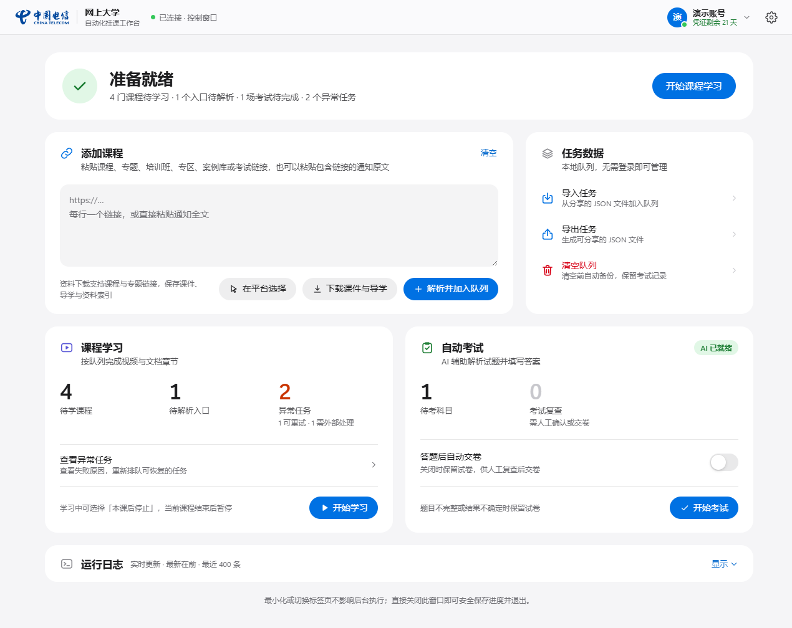
</picture>

截图中的账号、任务与模型列表均为演示数据，图片统一保存在 `assets/`。下面按实际操作顺序介绍各个工作流。

## 安装与启动

安装 **Node.js 24.22.0 或更高版本**，以及 Microsoft Edge 或 Google Chrome。

```sh
npm ci
npm run build
npm run console
```

日常使用这两个快捷命令即可：

| 命令              | 用途                                                                             | 何时使用                           |
| ----------------- | -------------------------------------------------------------------------------- | ---------------------------------- |
| `npm run build`   | 编译 TypeScript，再运行编译后的 `tools/copy-assets.ts`，将网页资源复制到 `dist/` | 首次使用，或更新代码、页面、样式后 |
| `npm run console` | 直接启动 `dist/src/main.js`，打开 Web 工作台                                     | 已编译后的日常启动                 |

更新后先关闭正在运行的工作台，再执行 `npm run build` 和 `npm run console`。也可用 `npm start` 一次完成编译和启动。`console` 是 npm 自定义脚本，完整写法是 `npm run console`。

Windows 默认查找 Edge，其次 Chrome；macOS 默认查找 Chrome，其次 Edge。

工作台默认监听 `http://127.0.0.1:9999`，启动后自动打开。界面采用扁平的 Apple 风格设计，跟随系统的浅色或深色外观，并适配窄屏窗口。

浏览器以可见窗口运行，使用项目独立的 `data/browser-profile/`，后续启动继续复用。这个本地个人资料关闭浏览器账号自动登录、同步和扩展，不使用日常浏览器的个人资料。

## 配置

点击工作台右上角的齿轮按钮打开 **设置**，填写并保存。无需复制配置模板或编辑环境文件。

- **AI**：填写接口地址和 API Key，点击 **获取模型**，再从下拉框选择；输入名称会即时筛选候选项，也可直接填写自定义模型。支持鼠标和方向键、Enter 选择，Esc 收起列表。选择 Responses 或 Chat Completions 协议。默认接口地址为 `https://api.openai.com/v1`；可以填写提供相同协议的接口。
- **高级设置**：调整答案输出格式、请求超时、重试次数、学习进度检查间隔和章节期限。
- **浏览器**：留空自动查找，也可以填写可执行文件的完整路径，重启后生效。

设置统一保存在 `data/settings.json`，下次启动自动读取。API Key 不会回显到页面；留空保存会保留已有密钥，也可勾选清除。AI 与学习设置在下一轮任务中生效。未配置 AI 时仍可学习课程和下载资料。

获取模型无需平台登录，使用当前表单中的地址和密钥，不会自动保存设置。地址不变时可使用已保存的密钥；更换地址后需填写对应的 API Key。列表来自该接口的 `/models`，接口不提供列表时仍可手动填写模型名称。

<details>
<summary>查看 AI 设置界面</summary>

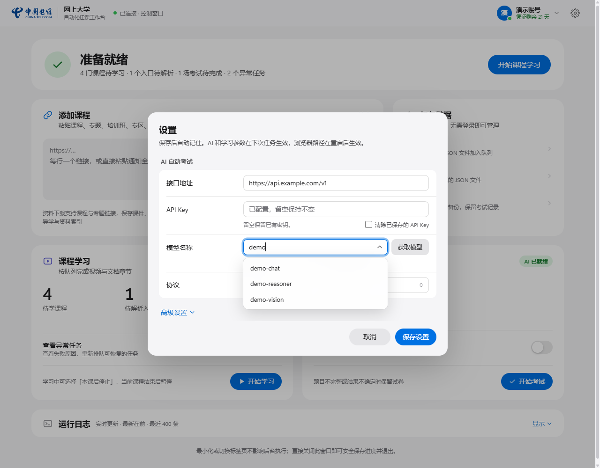

</details>

## 使用

1. 点击顶部状态卡片的 **登录账号**，或在右上角的账号菜单中选择 **登录 / 更新凭证**，在平台页面完成登录；工作台会核验账号并保存登录凭证。状态卡片始终给出下一步建议，例如开始学习或更新过期的凭证。
2. 在 **添加课程** 中粘贴课程、主题、培训班、专区、案例库或考试链接，点击 **解析并加入队列**。系统展开当前专题内的学习资源、去重并保留来源关系；跨专题的延伸入口可单独录入。部分入口失败时已发现的任务仍会保留。
3. 点击 **开始学习**，按队列处理课程。完成状态以平台返回的章节进度为准。
4. 点击 **开始考试**，使用已配置的模型辅助答题。**答题后自动交卷默认关闭**；题目不完整、剩余次数不足或结果不确定时保留试卷供人工复查。
5. 点击 **下载课件与导学**，保存课程或主题内的 PDF、Word、PowerPoint 课件以及导学内容和资料索引。

也可点击 **在平台选择**，在打开的入口页中点击所需资源，工作台记录课程或考试链接，选完后回到工作台确认。

### 课程学习流程

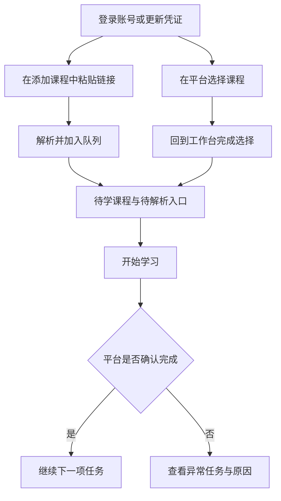

学习期间，顶部显示当前章节和时间进度。**本课后停止** 会在当前课程结束后暂停后续任务；**取消任务** 会结束本轮操作，保留待办供下次继续。

<details>
<summary>查看学习中的进度与操作按钮</summary>

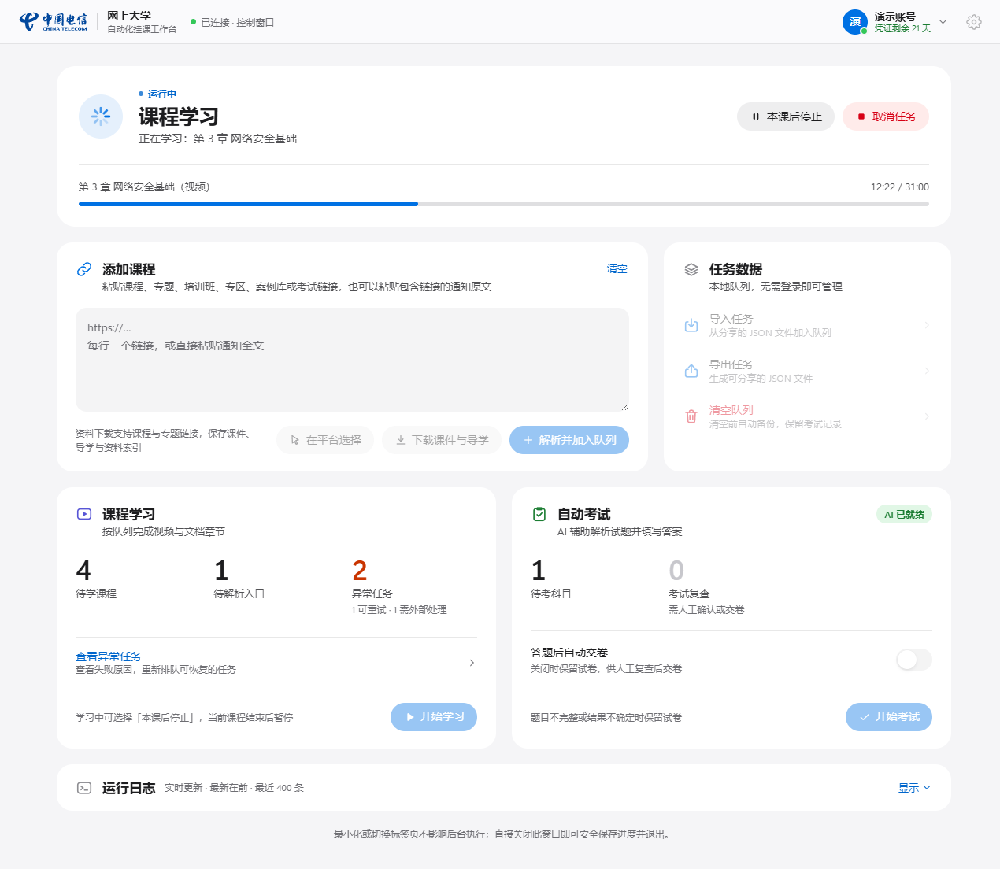

</details>

### AI 考试流程

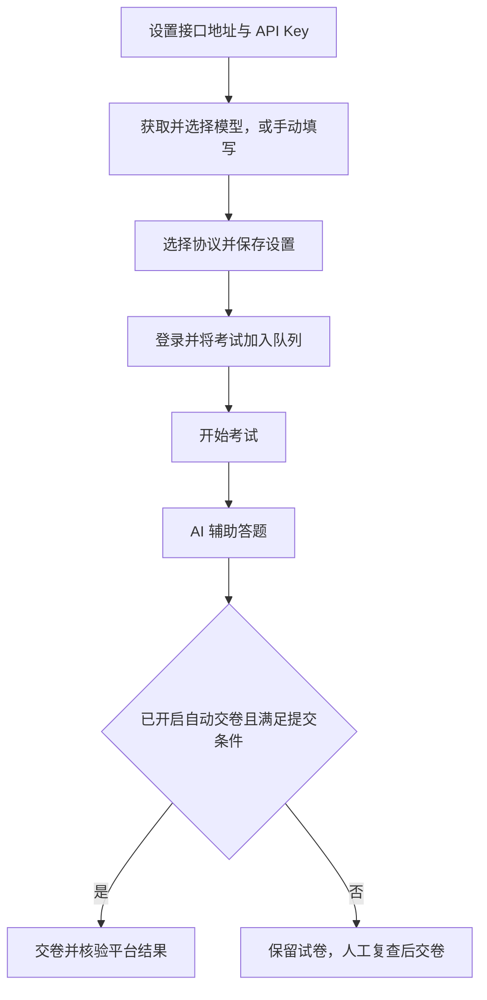

自动交卷默认关闭。即使开启，题目不完整、剩余机会不足或结果不确定时，仍会保留试卷供人工处理；是否通过以平台结果为准。

### 课件与导学下载流程

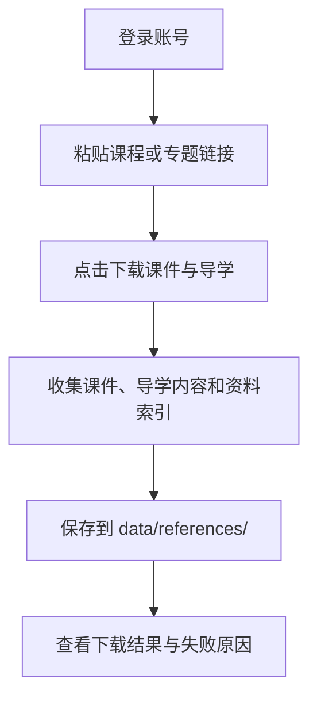

下载资料无需先完成课程学习，也不会改变学习完成状态。文件按账号和课程保存，可从 `data/references/` 中查看。

### 失败处理与继续解析

解析使用统一的任务图：去重、循环检测、专题边界与空分支剪枝对所有入口使用相同规则。单个入口失败时，已经发现的课程和其他分支继续保留，父入口等待未完成的子入口，不会被误标为完成。

失败任务退出执行队列，并在课程学习卡片的 **查看异常任务** 中显示链接和原因。恢复策略由操作返回的状态决定，不按专题 URL、课程 ID 或错误文案匹配特例：技术故障可以重新排队；权限、报名窗口、审核或人工步骤等阻塞需要外部条件改变后重新检查。重新解析专题时，受阻子入口保持暂停；单独录入该入口，或点击 **重新检查受阻任务**，可以重新核验。本版只处理当前数据结构，不迁移旧记录。

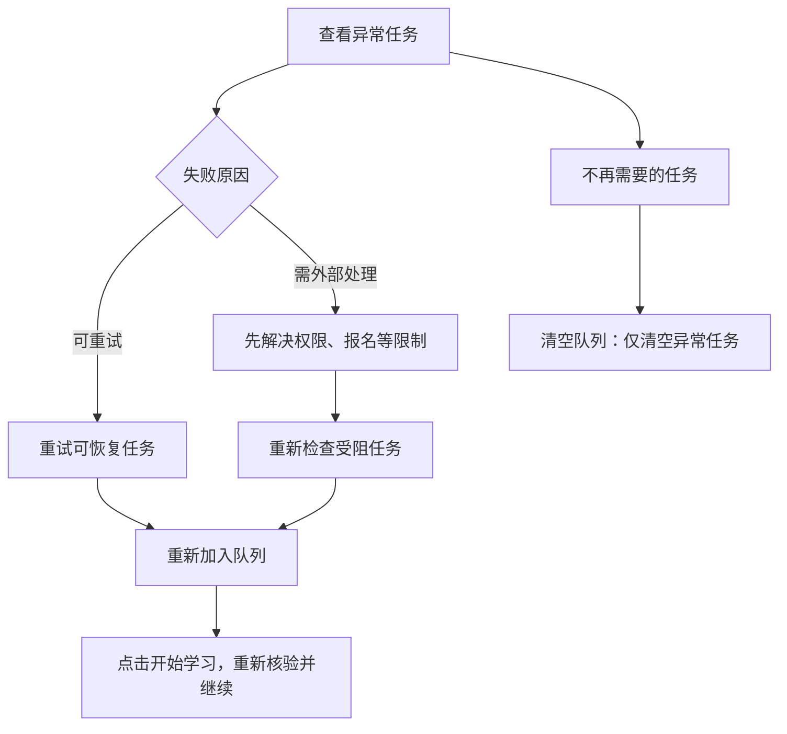

<details>
<summary>查看异常原因与重试入口</summary>

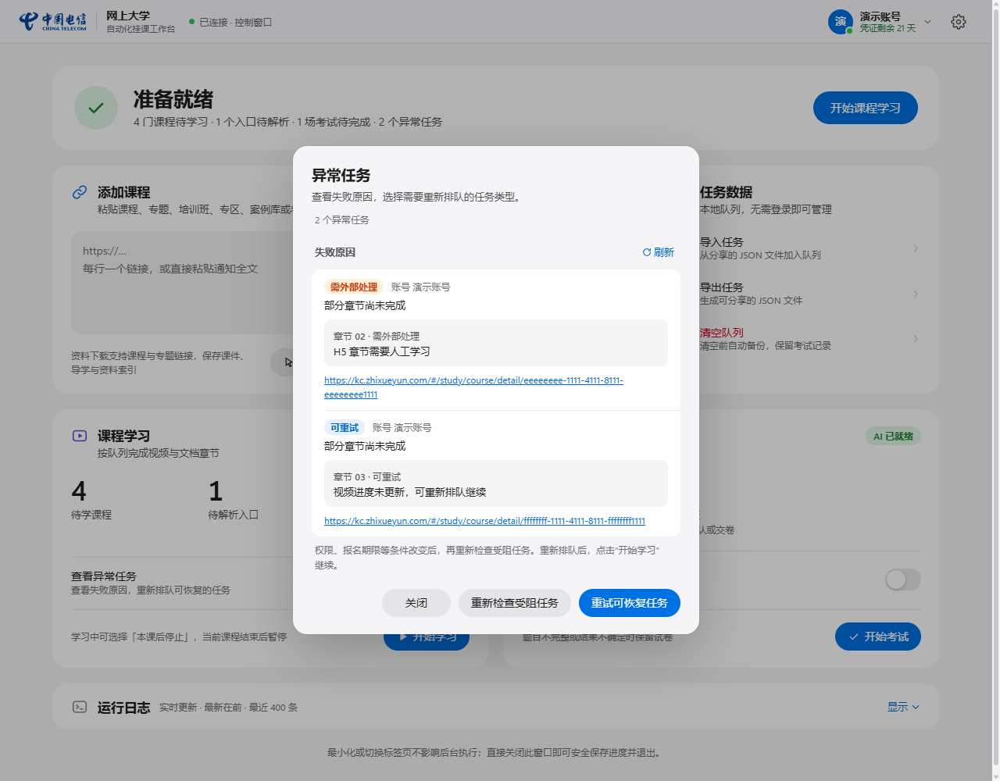

</details>

### 本地队列与分发

**任务数据** 卡片中的导入、导出和清空，以及查看原因、重新排队均无需平台登录。存在多个账号的本地数据时先选择范围；清空前自动备份，考试历史和未确认的提交记录保留。实际解析平台页面、学习、考试及下载课件仍需登录。

**清空队列** 在同一个表单中选择账号和清空范围：

- **仅清空异常任务**：包含可重试和需外部处理的任务，保留正常待学课程与待解析入口。
- **清空全部课程**：包含待学、待解析及异常任务，不影响考试队列。
- **清空考试队列**：包含待考和待复查的考试。
- **清空全部待办**：包含以上全部课程与考试任务。

点击清空按钮后才执行，取消或按 Esc 关闭表单不启动任何操作。

<details>
<summary>查看清空队列的四种范围</summary>

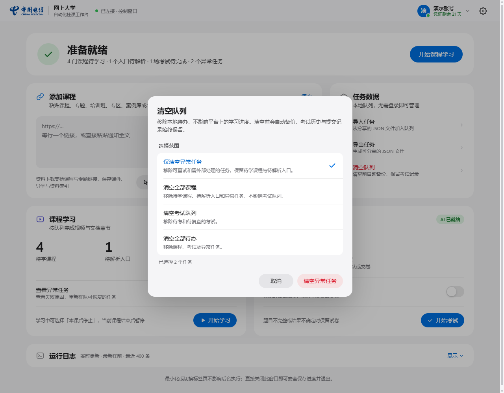

</details>

1. 点击 **导出任务**，在表单中选择账号与任务范围，再点击 **导出 JSON**。
2. 在摘要中点击 **下载 JSON 文件**。文件也保存在 `data/exports/`，可直接发给其他使用者。
3. 接收者点击 **导入任务**，选择该 JSON 文件。未登录时先存入本地导入队列，登录并开始学习或考试后归入核验后的账号；已有账号时直接加入该账号的队列。

文件包含任务链接、来源关系及失败原因；章节失败时，异常列表和 JSON 都保留章节编号、具体原因及恢复方式。文件不包含账号凭证、API Key、考试答案、提交记录或他人的完成进度。

导入使用本版导出的 JSON 结构，去重并保留本地已有完成状态；他人的失败原因仅作参考，实际权限与进度由接收者的账号重新核验。合并多个账号的来源关系时，循环引用不会加入执行依赖，对应任务仍正常导入；来源关系不会自动展开为其他未选中的课程。不提供旧格式兼容或自动修复。

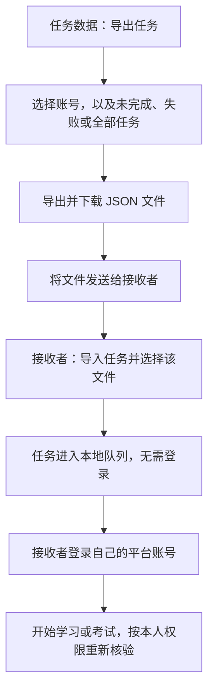

学习、考试等任务运行时可在顶部状态卡片中取消，学习任务还支持 **本课后停止**。运行中仍可编辑下一批链接、查看异常任务；清空和重新排队等修改操作在当前任务结束后可用。空链接在输入框旁直接提示，不会先要求登录。操作结果显示在状态卡片下方的摘要中，完成或失败的提示从页面底部弹出；详细运行日志按需展开。可直接报名的免费培训班会自动报名；报名已截止、需要审核或补充资料的入口会显示具体原因。

一个应用实例复用一个浏览器与 context，管理页与业务标签共享登录环境。切换账号或更新凭证会清理平台会话并重新核验，管理页保持登录。账号菜单中的 **关闭服务** 会收尾当前工作，结束后关闭应用拥有的浏览器。

<details>
<summary>查看窄屏界面</summary>

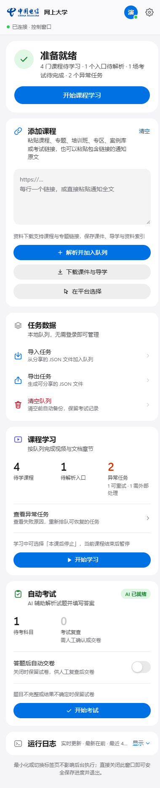

</details>

## 文件位置

| 路径                    | 内容                                     |
| ----------------------- | ---------------------------------------- |
| `data/settings.json`    | AI、浏览器和学习设置                     |
| `data/credentials.json` | 平台登录凭证                             |
| `data/browser-profile/` | 项目专用浏览器个人资料                   |
| `data/workbench.sqlite` | 各账号任务、队列、运行记录与考试复查状态 |
| `data/references/`      | 按账号与课程保存的课件、导学及索引       |
| `data/backups/`         | 清空队列前的数据库备份                   |
| `data/exports/`         | 从工作台导出的队列明细                   |
| `logs/`                 | 运行日志                                 |

`data/` 含有凭证和 API Key，请仅在可信设备保存，不要上传到公共仓库。运行数据与配置均已从 Git 中排除。

## 开发与检查

```sh
npm run check
npm run build
npm test
npm run check-startup
```

默认测试使用模拟协议和 HTTP 服务，不启动浏览器。真实浏览器测试需要显式开启，整轮复用一个可见浏览器和启动时的同一个标签页，直接导航到各测试页面，不保留多余空白页；独立测试配置保存在 `build/browser-tests/browser-profile/`，后续测试继续复用，并在启动前检查密码检测缓存：

```powershell
$env:COURSE_AFK_BROWSER_TEST='1'
npm run build
npm run test:browser
```

```sh
COURSE_AFK_BROWSER_TEST=1 npm run test:browser
```

关闭工作台后，可用 `npm run state` 查看数据数量，或用 `npm run state -- --output build/state.json` 导出任务记录。部署使用 `npm ci` 安装锁定依赖，`npm run build` 构建后运行 `npm run console`。
